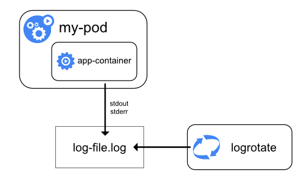
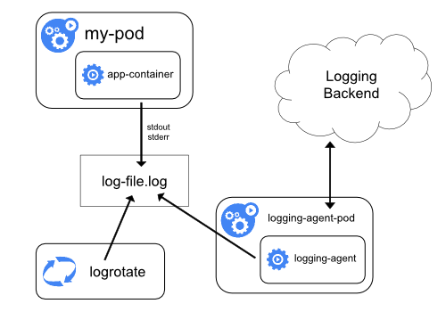
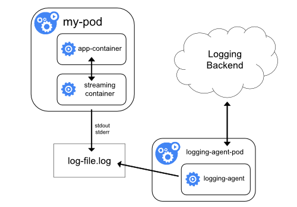
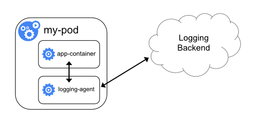
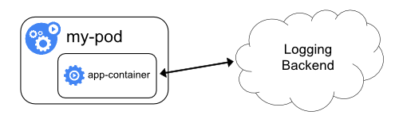

<!-- overview -->

Логи застосунків можуть допомогти вам зрозуміти, що відбувається всередині застосунку. Логи особливо корисні для налагодження проблем і моніторингу активності кластера. Більшість сучасних застосунків мають певний механізм логування. Так само рушії контейнерів розроблені з підтримкою логування. Найпростіший і найпоширеніший метод логування для контейнеризованих застосунків — запис у стандартні потоки виводу та помилок.

Однак вбудованих можливостей рушія контейнерів або середовища виконання зазвичай недостатньо для повноцінного рішення для логування.

Наприклад, вам може знадобитися доступ до логів застосунку, якщо контейнер зазнає збою, Pod буде виселено або вузол вийде з ладу.

У кластері логи повинні мати окреме сховище та життєвий цикл, незалежний від вузлів, Podʼів чи контейнерів. Ця концепція називається [логуванням на рівні кластера](#cluster-level-logging-architectures).

Архітектури логування на рівні кластера потребують окремого бекенду для зберігання, аналізу та запитів до логів. Kubernetes не надає власного рішення для зберігання логів. Натомість існує багато рішень для логування, які інтегруються з Kubernetes. У наведених нижче розділах описано, як обробляти та зберігати логи на вузлах.

<!-- body -->

## Логи Podʼів та контейнерів {#basic-logging-in-kubernetes}

Kubernetes збирає логи з кожного контейнера в запущеному Podʼі.

У цьому прикладі використовується маніфест `Pod` з контейнером, який раз на секунду записує текст у стандартний потік виводу.

{}

Щоб запустити цей Pod, використайте таку команду:

```shell
kubectl apply -f https://k8s.io/examples/debug/counter-pod.yaml
```

Вивід буде таким:

```console
pod/counter created
```

Для отримання логів використовуйте команду `kubectl logs`, як показано нижче:

```shell
kubectl logs counter
```

Вивід буде схожим на:

```console
0: Fri Apr  1 11:42:23 UTC 2022
1: Fri Apr  1 11:42:24 UTC 2022
2: Fri Apr  1 11:42:25 UTC 2022
```

Ви можете використовувати `kubectl logs --previous` для отримання логів з попереднього запуску контейнера. Якщо ваш Pod має кілька контейнерів, вкажіть, логи якого контейнера ви хочете переглянути, додавши назву контейнера до команди з прапорцем `-c`, ось так:

```shell
kubectl logs counter -c count
```

### Потоки логів контейнерів {#container-log-streams}



Як альфа-можливість, kubelet може розділяти логи двох стандартних потоків, які створює контейнер: [стандартного виводу](https://en.wikipedia.org/wiki/Standard_streams#Standard_output_(stdout)) та [стандартного потоку помилок](https://en.wikipedia.org/wiki/Standard_streams#Standard_error_(stderr)). Щоб скористатися цією поведінкою, потрібно ввімкнути функціональну можливість [`PodLogsQuerySplitStreams`](/docs/reference/command-line-tools-reference/feature-gates/#PodLogsQuerySplitStreams). З увімкненою функціональною можливістю Kubernetes  надає доступ до цих потоків логів безпосередньо через Pod API. Ви можете отримати конкретний потік, вказавши його назву (`Stdout` або `Stderr`) за допомогою рядка запиту `stream`. Ви повинні мати доступ на читання субресурсу `log` цього Podʼа.

Щоб продемонструвати цю можливість, ви можете створити Pod, який періодично записуватиме текст як до стандартного потоку виводу, так і до потоку помилок.

{}

Щоб запустити цей Pod, використайте таку команду:

```shell
kubectl apply -f https://k8s.io/examples/debug/counter-pod-err.yaml
```

Щоб отримати лише потік логів stderr, можна виконати команду:

```shell
kubectl get --raw "/api/v1/namespaces/default/pods/counter-err/log?stream=Stderr"
```

Докладніше дивіться в [документації `kubectl logs`](/docs/reference/generated/kubectl/kubectl-commands#logs).

### Як вузли обробляють логи контейнерів {#how-nodes-handle-container-logs}



Середовище виконання контейнерів обробляє та перенаправляє весь вивід у потоки `stdout` та `stderr` контейнеризованого застосунку. Різні середовища виконання контейнерів реалізують це по-різному; однак інтеграцію з kubelet стандартизовано як _формат логування CRI_.

Стандартно, якщо контейнер перезапускається, kubelet зберігає один завершений контейнер з його логами. Якщо Pod виселяється з вузла, усі відповідні контейнери також виселяються разом зі своїми логами.

kubelet надає клієнтам доступ до логів через спеціальну можливість API Kubernetes. Зазвичай доступ до неї здійснюється за допомогою команди `kubectl logs`.

### Ротація логів {#log-rotation}



kubelet відповідає за ротацію логів контейнерів і керування структурою тек логів. kubelet передає цю інформацію середовищу виконання контейнерів (через CRI), а середовище виконання записує логи контейнерів у вказане місце.

Ви можете налаштувати два [параметри конфігурації](/docs/reference/config-api/kubelet-config.v1beta1/) kubelet, `containerLogMaxSize` (стандартно 10Mi) та `containerLogMaxFiles` (стандартно 5), за допомогою [файлу конфігурації kubelet](/docs/tasks/administer-cluster/kubelet-config-file/). Ці параметри дозволяють налаштувати максимальний розмір кожного файлу логу та максимальну кількість файлів для кожного контейнера відповідно.

Для ефективної ротації логів у кластерах, де робочі навантаження генерують великий обсяг логів, kubelet також надає механізм налаштування ротації: кількості одночасних ротацій логів та інтервалу, з яким логи відстежуються й за потреби ротуються. Ви можете налаштувати два [параметри конфігурації](/docs/reference/config-api/kubelet-config.v1beta1/) kubelet, `containerLogMaxWorkers` та `containerLogMonitorInterval`, за допомогою [файлу конфігурації kubelet](/docs/tasks/administer-cluster/kubelet-config-file/).

Коли ви виконуєте [`kubectl logs`](/docs/reference/generated/kubectl/kubectl-commands#logs), як у прикладі базового логування, kubelet на вузлі обробляє запит і читає безпосередньо з файлу логу. kubelet повертає вміст файлу логу.


Через `kubectl logs` доступний лише вміст останнього файлу логу.

Наприклад, якщо Pod пише 40 MiB логів і kubelet ротує логи після 10 MiB, виконання `kubectl logs` поверне максимум 10MiB даних.


## Логи системних компонентів {#system-component-logs}

Є два види системних компонентів: ті, що зазвичай працюють у контейнері, і ті, що безпосередньо беруть участь у запуску контейнерів. Наприклад:

* kubelet і середовище виконання контейнерів не працюють у контейнерах. kubelet запускає ваші контейнери (згруповані в ).
* Планувальник Kubernetes, менеджер контролерів та API-сервер працюють у Podʼах (зазвичай ). Компонент etcd працює в панелі управління, найчастіше також як статичний Pod. Якщо ваш кластер використовує kube-proxy, зазвичай його запускають як `DaemonSet`.

### Розташування логів {#log-location-node}

Те, як kubelet і середовище виконання контейнерів записують логи, залежить від операційної системи вузла:


{}

На вузлах Linux, які використовують systemd, kubelet і середовище виконання контейнерів стандартно пишуть у journald. Для читання журналу systemd використовуйте `journalctl`; наприклад: `journalctl -u kubelet`.

Якщо systemd немає, kubelet і середовище виконання контейнерів пишуть у файли `.log` у теці `/var/log`. Якщо ви хочете, щоб логи записувалися в інше місце, можна запускати kubelet опосередковано через допоміжний інструмент `kube-log-runner` і за допомогою нього перенаправляти логи kubelet у вибрану вами теку.

Стандартно kubelet вказує середовищу виконання контейнерів записувати логи в теки всередині `/var/log/pods`.

Докладніше про `kube-log-runner` читайте в [Системних логах](/docs/concepts/cluster-administration/system-logs/#klog).

{}
{}

Стандартно kubelet записує логи у файли всередині теки `C:\var\logs` (зверніть увагу, що це не `C:\var\log`).

Хоча `C:\var\log` є стандартним розташуванням цих логів у Kubernetes, деякі інструменти розгортання кластера налаштовують вузли Windows так, щоб логи записувалися в `C:\var\log\kubelet`.

Якщо ви хочете, щоб логи записувалися в інше місце, можна запускати kubelet опосередковано через допоміжний інструмент `kube-log-runner` і за допомогою нього перенаправляти логи kubelet у вибрану вами теку.

Однак стандартно kubelet вказує середовищу виконання контейнерів записувати логи в теку `C:\var\log\pods`.

Докладніше про `kube-log-runner` читайте в [Системних логах](/docs/concepts/cluster-administration/system-logs/#klog).
{}


<br /><!-- work around rendering nit -->

Компоненти кластера Kubernetes, які працюють у Podʼах, пишуть у файли всередині теки `/var/log`, оминаючи стандартний механізм логування (ці компоненти не пишуть у журнал systemd). Ви можете використовувати механізми сховища Kubernetes, щоб підключити постійне сховище до контейнера, у якому працює компонент.

kubelet дозволяє змінити теку логів Podʼів зі стандартної `/var/log/pods` на власний шлях. Це можна зробити за допомогою параметра `podLogsDir` у файлі конфігурації kubelet.


Важливо зазначити, що стандартне розташування `/var/log/pods` використовувалося протягом тривалого часу, і певні процеси можуть неявно використовувати цей шлях. Тому до зміни цього параметра слід підходити з обережністю і на власний ризик.

Ще одне застереження: kubelet підтримує розташування на тому самому диску, що й `/var`. В іншому разі, якщо логи розташовані в окремій від `/var` файловій системі, kubelet не відстежуватиме використання цієї файлової системи, що може призвести до проблем, якщо вона заповниться.



Докладніше про etcd та його логи дивіться в [документації etcd](https://etcd.io/docs/). Знову ж таки, ви можете використовувати механізми сховища Kubernetes, щоб підключити постійне сховище до контейнера, у якому працює компонент.


Якщо ви розгортаєте компоненти кластера Kubernetes (наприклад, планувальник) так, щоб вони писали логи в том, спільний із батьківським вузлом, вам потрібно подбати про ротацію цих логів. **Kubernetes не керує цією ротацією логів**.

Ваша операційна система може автоматично виконувати певну ротацію логів — наприклад, якщо ви надаєте статичному Podʼу компонента спільний доступ до теки `/var/log`, ротація логів на рівні вузла обробляє файл у цій теці так само, як файл, записаний будь-яким компонентом поза Kubernetes.

Деякі інструменти розгортання враховують цю ротацію логів та автоматизують її; інші залишають це на вашу відповідальність.


## Архітектури логування на рівні кластера {#cluster-level-logging-architectures}

Хоча Kubernetes не надає власного рішення для логування на рівні кластера, існує кілька поширених підходів, які ви можете розглянути. Ось деякі варіанти:

* Використання агента логування на рівні вузла, який працює на кожному вузлі.
* Додавання в Pod застосунку спеціального sidecar-контейнера для логування.
* Надсилання логів безпосередньо до бекенду із застосунку.

### Використання агента логування на рівні вузла {#using-a-node-logging-agent}



Ви можете реалізувати логування на рівні кластера, розмістивши на кожному вузлі _агент логування на рівні вузла_. Агент логування — це спеціальний інструмент, який відкриває доступ до логів або надсилає їх до бекенду. Зазвичай агент логування — це контейнер, який має доступ до теки з файлами логів усіх контейнерів застосунків на цьому вузлі.

Оскільки агент логування повинен працювати на кожному вузлі, рекомендується запускати агента
як `DaemonSet`.

Логування на рівні вузла створює лише одного агента на вузол і не вимагає жодних змін у застосунках, що працюють на вузлі.

Контейнери пишуть у stdout та stderr, але без узгодженого формату. Агент на рівні вузла збирає
ці логи та пересилає їх для агрегації.

### Використання sidecar-контейнера з агентом логування {#sidecar-container-with-logging-agent}

Ви можете використовувати sidecar-контейнер одним із таких способів:

* Sidecar-контейнер транслює логи застосунку у свій власний `stdout`.
* У sidecar-контейнері працює агент логування, налаштований збирати логи з контейнера застосунку.

#### Sidecar-контейнер для трансляції {#streaming-sidecar-container}



Якщо ваші sidecar-контейнери пишуть у власні потоки `stdout` та `stderr`, ви можете скористатися kubelet та агентом логування, які вже працюють на кожному вузлі. Sidecar-контейнери читають логи з файлу, сокета або journald. Кожен sidecar-контейнер виводить лог у свій власний потік `stdout` або `stderr`.

Цей підхід дозволяє розділити кілька потоків логів із різних частин вашого застосунку, деякі з яких можуть не підтримувати запис у `stdout` або `stderr`. Логіка перенаправлення логів мінімальна, тому це не створює значних накладних витрат. Крім того, оскільки `stdout` та `stderr` обробляє kubelet, ви можете використовувати вбудовані інструменти, такі як `kubectl logs`.

Наприклад, у Podʼі працює один контейнер, який записує до двох різних файлів логів у двох різних форматах. Ось маніфест для Podʼа:

{}

Не рекомендується записувати записи логів різних форматів в один потік логів, навіть якщо вам вдалося перенаправити обидва компоненти до потоку `stdout` контейнера. Натомість можна створити два sidecar-контейнери. Кожен sidecar-контейнер може читати кінець певного файлу логів зі спільного тому й перенаправляти логи до власного потоку `stdout`.

Ось маніфест для Podʼа, в якому є два sidecar-контейнери:

{}

Тепер, коли ви запускаєте цей Pod, ви можете отримати доступ до кожного потоку логів окремо, запустивши такі команди:

```shell
kubectl logs counter count-log-1
```

Результат буде подібним до:

```console
0: Fri Apr  1 11:42:26 UTC 2022
1: Fri Apr  1 11:42:27 UTC 2022
2: Fri Apr  1 11:42:28 UTC 2022
...
```

```shell
kubectl logs counter count-log-2
```

Результат буде подібним до:

```console
Fri Apr  1 11:42:29 UTC 2022 INFO 0
Fri Apr  1 11:42:30 UTC 2022 INFO 0
Fri Apr  1 11:42:31 UTC 2022 INFO 0
...
```

Якщо ви встановили у свій кластер агент на рівні вузла, цей агент автоматично збиратиме ці потоки логів без додаткової конфігурації. За бажанням ви можете налаштувати агент на розбір рядків логів залежно від контейнера-джерела.

Навіть для Podʼів із низьким використанням CPU та памʼяті (порядку кількох мілікорів CPU та кількох мегабайтів памʼяті) запис логів у файл і їх подальша трансляція до `stdout` можуть подвоїти обсяг сховища, потрібний на вузлі. Якщо у вас є застосунок, який пише в один файл, рекомендується встановити `/dev/stdout` як місце призначення, а не застосовувати підхід із sidecar-контейнером для трансляції.

Sidecar-контейнери також можна використовувати для ротації файлів логів, які не може ротувати сам застосунок. Прикладом такого підходу є невеликий контейнер, який періодично запускає `logrotate`. Однак простіше використовувати `stdout` та `stderr` безпосередньо й залишити ротацію та політики зберігання kubelet.

#### Sidecar-контейнер з агентом логування {#sidecar-container-with-a-logging-agent}



Якщо агент логування на рівні вузла недостатньо гнучкий для вашої ситуації, ви можете створити sidecar-контейнер з окремим агентом логування, налаштованим спеціально для роботи з вашим застосунком.


Використання агента логування в sidecar-контейнері може призвести до значного споживання ресурсів. Крім того, ви не зможете отримати доступ до цих логів за допомогою `kubectl logs`, оскільки вони не контролюються kubelet.


Ось два приклади маніфестів, які ви можете використати для реалізації sidecar-контейнера з агентом логування. Перший маніфест містить [`ConfigMap`](/docs/tasks/configure-pod-container/configure-pod-configmap/) для налаштування fluentd.

{}


У конфігураціях з прикладів ви можете замінити fluentd на будь-який агент логування, який читає з будь-якого джерела всередині контейнера застосунку.


Другий маніфест описує Pod із sidecar-контейнером, у якому працює fluentd. Pod монтує том, звідки fluentd може отримати свої конфігураційні дані.

{}

### Надання логів безпосередньо із застосунку {#exposing-logs-directly-from-the-application}



Логування на рівні кластера, яке відкриває доступ до логів або надсилає їх безпосередньо з кожного застосунку, виходить за межі Kubernetes.

## {} {#whats-next}

* Дізнайтеся про [системні логи Kubernetes](/docs/concepts/cluster-administration/system-logs/)
* Дізнайтеся про [трейси для системних компонентів Kubernetes](/docs/concepts/cluster-administration/system-traces/)
* Дізнайтеся, як [налаштувати повідомлення про завершення](/docs/tasks/debug/debug-application/determine-reason-pod-failure/#customizing-the-termination-message), яке Kubernetes записує, коли Pod зазнає збою
