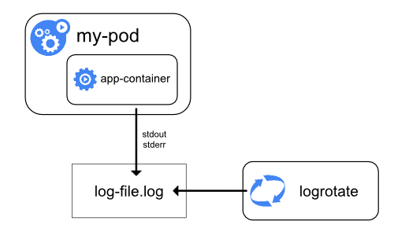

<!-- overview -->

У Kubernetes спостережуваність — це процес збору та аналізу метрик, логів і трейсів (їх часто називають трьома стовпами спостережуваності), щоб краще зрозуміти внутрішній стан, продуктивність і справність кластера.

Компоненти панелі управління Kubernetes, а також багато надбудов генерують і надсилають ці сигнали. Обʼєднуючи та корелюючи їх, ви можете отримати єдину картину панелі управління, надбудов і застосунків у всьому кластері.

На схемі 1 показано, як компоненти кластера надсилають три основні типи сигналів.


flowchart LR
    A[Компоненти кластера] --> M[Конвеєр метрик]
    A --> L[Конвеєр логів]
    A --> T[Конвеєр трейсів]
    M --> S[(Зберігання та аналіз)]
    L --> S
    T --> S
    S --> O[Оператори та автоматизація]


*Схема 1. Високорівневі сигнали, які надсилають компоненти кластера, та їх споживачі.*

<!-- body -->
## Метрики {#metrics}

Компоненти Kubernetes надають метрики у [форматі Prometheus](https://prometheus.io/docs/instrumenting/exposition_formats/) через свої точки доступу `/metrics`, зокрема:

- kube-controller-manager
- kube-proxy
- kube-apiserver
- kube-scheduler
- kubelet

kubelet також надає метрики через `/metrics/cadvisor`, `/metrics/resource` та `/metrics/probes`, а надбудови, такі як [kube-state-metrics](/docs/concepts/cluster-administration/kube-state-metrics/), доповнюють ці сигнали панелі управління статусом обʼєктів Kubernetes.

Типовий конвеєр метрик Kubernetes періодично опитує ці точки доступу та зберігає отримані зразки в базі даних часових рядів (наприклад, у Prometheus).

Докладніше про це та про параметри конфігурації дивіться в [посібнику із системних метрик](/docs/concepts/cluster-administration/system-metrics/).

На схемі 2 показано типовий конвеєр метрик Kubernetes.


flowchart LR
    C[Компоненти кластера] --> P[Збирач Prometheus]
    P --> TS[(Сховище часових рядів)]
    TS --> D[Dashboards та сповіщення]
    TS --> A[Автоматизовані дії]


*Схема 2. Компоненти типового конвеєра метрик Kubernetes.*

Для спостережуваності в кількох кластерах або хмарах Prometheus можуть доповнити розподілені бази даних часових рядів (наприклад, Thanos або Cortex).

Інструменти збору метрик і бази даних часових рядів дивіться в розділі [Поширені інструменти спостережуваності — інструменти метрик](#metrics-tools).

### API метрик {#metrics-api}



API метрик Kubernetes надає дані про використання CPU та памʼяті вузлами та Podʼами. Команда `kubectl top` та такі компоненти, як [HorizontalPodAutoscaler](/docs/concepts/workloads/autoscaling/horizontal-pod-autoscale/) і [VerticalPodAutoscaler](/docs/concepts/workloads/autoscaling/vertical-pod-autoscale/), використовують цей API.

`kubectl top` підтримує як `metrics.k8s.io/v1`, так і `metrics.k8s.io/v1beta1`. Він надає перевагу `v1`, коли ця версія доступна, і повертається до `v1beta1`. У Kubernetes v1.37 контролер HorizontalPodAutoscaler підтримує лише `metrics.k8s.io/v1beta1`; підтримка `metrics.k8s.io/v1` запланована, але ще недоступна.

На відміну від точок доступу метрик компонентів, описаних раніше, API метрик обслуговується через [шар агрегації API](/docs/concepts/extend-kubernetes/api-extension/apiserver-aggregation/) Kubernetes. У вашому кластері має працювати [Metrics Server](https://github.com/kubernetes-sigs/metrics-server) або інша реалізація цього API. API метрик навмисно надає лише метрики ресурсів, потрібні для автомасштабування та базової перевірки; він не замінює повноцінний конвеєр моніторингу.

Щоб дізнатися про API, його реалізації та потік даних від kubelet до його клієнтів, дивіться [конвеєр метрик ресурсів](/docs/tasks/debug/debug-cluster/resource-metrics-pipeline/).

#### {}

- [Системні метрики компонентів Kubernetes](/docs/concepts/cluster-administration/system-metrics/)
- [Моніторинг використання ресурсів за допомогою metrics-server](/docs/tasks/debug/debug-cluster/resource-usage-monitoring/)
- [Концепція kube-state-metrics](/docs/concepts/cluster-administration/kube-state-metrics/)

## Логи {#logs}

Логи містять хронологічні записи подій усередині застосунків, системних компонентів Kubernetes та дій, повʼязаних із безпекою, таких як логування аудиту.

Середовища виконання контейнерів отримують вивід контейнеризованого застосунку з потоків стандартного виводу (`stdout`) та стандартного виводу помилок (`stderr`). Хоча середовища виконання реалізують це по-різному, інтеграцію з kubelet стандартизовано через _формат логування CRI_, а kubelet робить ці логи доступними через `kubectl logs`.

*Схема 3a. Архітектура логування на рівні вузла.*

Логи системних компонентів фіксують події в кластері й часто корисні для налагодження та усунення несправностей. Ці компоненти поділяються на два види: ті, що працюють у контейнері, і ті, що працюють поза ним. Наприклад, `kube-scheduler` і `kube-proxy` зазвичай працюють у контейнерах, тоді як `kubelet` і середовище виконання контейнерів працюють безпосередньо на хості.

- На машинах із `systemd` kubelet і середовище виконання контейнерів пишуть у journald. В іншому разі вони пишуть у файли `.log` у теці `/var/log`.
- Системні компоненти, що працюють у контейнерах, завжди пишуть у файли `.log` у `/var/log`, оминаючи стандартний механізм логування контейнерів.

Логи системних компонентів і контейнерів, що зберігаються в `/var/log`, потребують ротації, щоб запобігти неконтрольованому зростанню. Деякі сценарії розгортання кластерів стандартно встановлюють ротацію логів; перевірте своє середовище та за потреби змініть налаштування. Докладніше про розташування, формати та параметри конфігурації дивіться в [довідці щодо системних логів](/docs/concepts/cluster-administration/system-logs/).

Більшість кластерів запускають агент логування на рівні вузла (наприклад, Fluent Bit або Fluentd), який стежить за цими файлами та пересилає записи до центрального сховища логів. У [посібнику з архітектури логування](/docs/concepts/cluster-administration/logging/) пояснюється, як проєктувати такі конвеєри, налаштовувати термін зберігання та спрямовувати потоки логів до бекендів.

На схемі 3 показано типовий конвеєр агрегації логів.


flowchart LR
    subgraph Джерела
        A[Вивід застосунку в stdout / stderr]
        B[Логи панелі управління]
        C[Записи аудиту]
    end
    A --> N[Агент логування на рівні вузла]
    B --> N
    C --> N
    N --> L[Центральне сховище логів]
    L --> Q[Dashboards, сповіщення, SIEM]


*Схема 3. Компоненти типового конвеєра логів Kubernetes.*

Агенти логування та центральні сховища логів дивіться в розділі [Поширені інструменти спостережуваності — інструменти логування](#logging-tools).

#### {}

- [Архітектура логування](/docs/concepts/cluster-administration/logging/)
- [Системні логи](/docs/concepts/cluster-administration/system-logs/)
- [Завдання та навчальні матеріали з логування](/docs/tasks/debug/logging/)
- [Налаштування логування аудиту](/docs/tasks/debug/debug-cluster/audit/)

## Трейси {#traces}

Трейси фіксують, як запити проходять через компоненти та застосунки Kubernetes, повʼязуючи затримки, час і взаємозвʼязки між операціями. Збираючи трейси, ви можете візуалізувати проходження запиту від початку до кінця, діагностувати проблеми з продуктивністю та виявляти вузькі місця або несподівані взаємодії в панелі управління, надбудовах чи застосунках.

Kubernetes  може експортувати відрізки (spans) через [OpenTelemetry Protocol](/docs/concepts/cluster-administration/system-traces/) (OTLP) — або безпосередньо через вбудовані експортери gRPC, або пересилаючи їх через OpenTelemetry Collector.

OpenTelemetry Collector отримує відрізки від компонентів і застосунків, обробляє їх (наприклад, застосовуючи відбір або редагування) і пересилає до бекенду трасування для зберігання та аналізу.

На схемі 4 показано типовий конвеєр розподіленого трасування.


flowchart LR
    subgraph Джерела
        A[Відрізки панелі управління]
        B[Відрізки застосунків]
    end
    A --> X[OTLP exporter]
    B --> X
    X --> COL[OpenTelemetry Collector]
    COL --> TS[(Бекенд трасування)]
    TS --> V[Візуалізація та аналіз]


*Схема 4. Компоненти типового конвеєра трасування Kubernetes.*

Колектори трасування та бекенди дивіться в розділі [Поширені інструменти спостережуваності — інструменти трасування](#tracing-tools).

#### {}

- [Системні трейси компонентів Kubernetes](/docs/concepts/cluster-administration/system-traces/)
- [Посібник із початку роботи з OpenTelemetry Collector](https://opentelemetry.io/docs/collector/getting-started/)
- [Завдання з моніторингу та трасування](/docs/tasks/debug/monitoring/)

## Поширені інструменти спостережуваності {#common-observability-tools}

{}

Примітка: цей розділ містить посилання на сторонні проєкти, які надають можливості спостережуваності, потрібні для Kubernetes. Автори проєкту Kubernetes не несуть відповідальності за ці проєкти, які перелічені в алфавітному порядку. Щоб додати проєкт до цього списку, перед внесенням змін прочитайте [посібник зі вмісту](/docs/contribute/style/content-guide/).

### Інструменти метрик {#metrics-tools}

- [Cortex](https://cortexmetrics.io/) пропонує горизонтально масштабоване, довгострокове сховище Prometheus.
- [Grafana Mimir](https://grafana.com/oss/mimir/) — проєкт Grafana Labs, який надає багатоорендне, горизонтально масштабоване сховище, сумісне з Prometheus.
- [Prometheus](https://prometheus.io/) — це система моніторингу, яка збирає та зберігає метрики з компонентів Kubernetes.
- [Thanos](https://thanos.io/) розширює Prometheus глобальними запитами, проріджуванням даних (downsampling) та підтримкою обʼєктного сховища.

### Інструменти логування {#logging-tools}

- [Elasticsearch](https://www.elastic.co/elasticsearch/) забезпечує розподілене індексування логів та пошук у них.
- [Fluent Bit](https://fluentbit.io/) збирає та пересилає логи контейнерів і вузлів із низьким споживанням ресурсів.
- [Fluentd](https://www.fluentd.org/) маршрутизує та перетворює логи, надсилаючи їх до кількох місць призначення.
- [Grafana Loki](https://grafana.com/oss/loki/) зберігає логи у форматі на основі міток, натхненному Prometheus.
- [OpenSearch](https://opensearch.org/) надає індексування логів і пошук із відкритим кодом, сумісні з API Elasticsearch.

### Інструменти трасування {#tracing-tools}

- [Grafana Tempo](https://grafana.com/oss/tempo/) пропонує масштабоване та недороге сховище розподілених трейсів.
- [Jaeger](https://www.jaegertracing.io/) збирає та візуалізує розподілені трейси для мікросервісів.
- [OpenTelemetry Collector](https://opentelemetry.io/docs/collector/) отримує, обробляє та експортує телеметричні дані, зокрема трейси.
- [Zipkin](https://zipkin.io/) забезпечує збір та візуалізацію розподілених трейсів.

## {} {#whats-next}

- Дізнайтесь, як [збирати метрики використання ресурсів за допомогою metrics-server](/docs/tasks/debug/debug-cluster/resource-usage-monitoring/)
- Перегляньте [завдання та навчальні матеріали з логування](/docs/tasks/debug/logging/)
- Спробуйте виконати [завдання з моніторингу та трасування](/docs/tasks/debug/monitoring/)
- Ознайомтесь із [посібником із системних метрик](/docs/concepts/cluster-administration/system-metrics/), щоб дізнатися про точки доступу компонентів та їх стабільність
- Перегляньте розділ [Поширені інструменти спостережуваності](#common-observability-tools), щоб знайти перевірені сторонні варіанти
