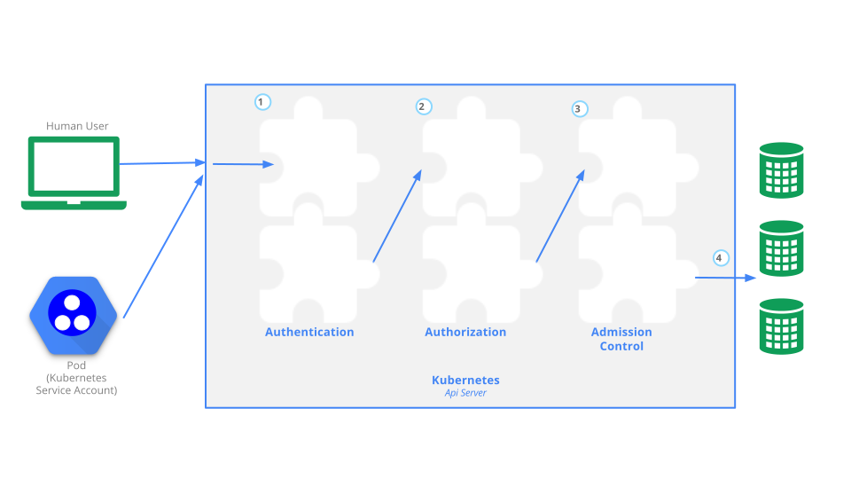

<!-- overview -->

На цій сторінці наведено огляд контролю доступу до API Kubernetes.

<!-- body -->

Користувачі отримують доступ до [API Kubernetes](/docs/concepts/overview/kubernetes-api/) за допомогою `kubectl`, клієнтських бібліотек або запитів REST. Авторизувати доступ до API можна як для людей, так і для [ServiceAccount Kubernetes](/docs/tasks/configure-pod-container/configure-service-account/). Коли запит досягає API, він проходить кілька етапів, показаних на цій схемі:



## Транспортна безпека {#transport-security}

Стандартно API-сервер Kubernetes прослуховує порт 6443 на першому мережевому інтерфейсі, відмінному від localhost, із захистом TLS. У типовому промисловому кластері Kubernetes API працює на порту 443. Порт можна змінити за допомогою прапорця `--secure-port`, а IP-адресу прослуховування — за допомогою прапорця `--bind-address`.

API-сервер надає сертифікат. Цей сертифікат може бути підписаний приватним центром сертифікації (CA) або базуватися на інфраструктурі відкритих ключів, повʼязаній із загальновизнаним CA. Сертифікат і відповідний приватний ключ можна задати за допомогою прапорців `--tls-cert-file` та `--tls-private-key-file`.

Якщо ваш кластер використовує приватний центр сертифікації, вам потрібна копія сертифіката цього CA, налаштована у вашому `~/.kube/config` на клієнті, щоб ви могли довіряти зʼєднанню та бути впевненими, що його не було перехоплено.

На цьому етапі ваш клієнт може надати клієнтський сертифікат TLS.

## Автентифікація {#authentication}

Після встановлення TLS HTTP-запит переходить до кроку автентифікації. На схемі це крок **1**. Сценарій створення кластера або адміністратор кластера налаштовує API-сервер на використання одного або кількох модулів автентифікації. Автентифікатори докладніше описані в розділі [Автентифікація](/docs/reference/access-authn-authz/authentication/).

Вхідними даними для кроку автентифікації є весь HTTP-запит; однак зазвичай перевіряються заголовки та/або клієнтський сертифікат.

Модулі автентифікації охоплюють клієнтські сертифікати, паролі та прості токени, токени bootstrap і JSON Web Tokens (використовуються для ServiceAccount).

Можна вказати кілька модулів автентифікації; у такому разі кожен із них пробується послідовно, доки один не спрацює успішно.

Якщо запит не може бути автентифікований, його буде відхилено з кодом статусу HTTP 401. В іншому разі користувач автентифікується як конкретний `username`, і це імʼя користувача доступне наступним крокам для прийняття рішень. Деякі автентифікатори також надають членство користувача в групах, а інші ні.

Хоча Kubernetes використовує імена користувачів для рішень щодо контролю доступу та в логах запитів, він не має обʼєкта `User` і не зберігає імена користувачів чи іншу інформацію про них у своєму API.

## Авторизація {#authorization}

Після того як запит автентифіковано як такий, що надійшов від певного користувача, його потрібно авторизувати. На схемі це крок **2**.

Запит має містити імʼя користувача, який його надсилає, запитану дію та обʼєкт, якого стосується дія. Запит авторизується, якщо наявна політика визначає, що користувач має дозвіл на виконання запитаної дії.

Наприклад, якщо у Боба є наведена нижче політика, він може читати Podʼи лише у просторі імен `projectCaribou`:

```json
{
    "apiVersion": "abac.authorization.kubernetes.io/v1beta1",
    "kind": "Policy",
    "spec": {
        "user": "bob",
        "namespace": "projectCaribou",
        "resource": "pods",
        "readonly": true
    }
}
```

Якщо Боб зробить такий запит, то він буде авторизований, оскільки він має дозвіл на читання обʼєктів у просторі імен `projectCaribou`:

```json
{
  "apiVersion": "authorization.k8s.io/v1beta1",
  "kind": "SubjectAccessReview",
  "spec": {
    "resourceAttributes": {
      "namespace": "projectCaribou",
      "verb": "get",
      "group": "unicorn.example.org",
      "resource": "pods"
    }
  }
}
```

Якщо Боб зробить запит на запис (`create` або `update`) обʼєктів у просторі імен `projectCaribou`, йому буде відмовлено в авторизації. Якщо Боб зробить запит на читання (`get`) обʼєктів в іншому просторі імен, наприклад `projectFish`, йому також буде відмовлено в авторизації.

Авторизація в Kubernetes потребує використання загальних атрибутів REST для взаємодії з наявними системами контролю доступу на рівні всієї організації або хмарного провайдера. Важливо використовувати форматування REST, оскільки ці системи контролю можуть взаємодіяти з іншими API, крім API Kubernetes.

Kubernetes підтримує кілька модулів авторизації, таких як режим ABAC, режим RBAC та режим Webhook. Коли адміністратор створює кластер, він налаштовує модулі авторизації, які використовуватиме API-сервер. Якщо налаштовано більше одного модуля авторизації, Kubernetes перевіряє кожен модуль, і якщо будь-який модуль авторизує запит, запит може виконуватися. Якщо всі модулі відхиляють запит, його буде відхилено (код статусу HTTP 403).

Докладніше про авторизацію в Kubernetes, зокрема про створення політик за допомогою підтримуваних модулів авторизації, дивіться в розділі [Авторизація](/docs/reference/access-authn-authz/authorization/).

## Контроль допуску {#admission-control}

Модулі контролю допуску — це програмні модулі, які можуть змінювати або відхиляти запити. Крім атрибутів, доступних модулям авторизації, модулі контролю допуску можуть отримувати доступ до вмісту обʼєкта, який створюється або змінюється.

Контролери допуску обробляють запити на створення, зміну, видалення обʼєкта або підключення до нього (проксі). Контролери допуску не обробляють запити, які лише читають обʼєкти. Коли налаштовано кілька контролерів допуску, вони викликаються по черзі.

На схемі це крок **3**.

На відміну від модулів автентифікації та авторизації, якщо будь-який модуль контролю допуску відхиляє запит, то запит негайно відхиляється.

Крім відхилення обʼєктів, контролери допуску також можуть встановлювати складні стандартні значення для полів.

Доступні модулі контролю допуску описані в розділі [Контролери допуску](/docs/reference/access-authn-authz/admission-controllers/).

Після того як запит пройде всі контролери допуску, його перевіряють за допомогою процедур валідації відповідного обʼєкта API, а потім записують у сховище обʼєктів (на схемі це крок **4**).

## Аудит {#auditing}

Аудит Kubernetes забезпечує важливий для безпеки хронологічний набір записів, що документують послідовність дій у кластері. Кластер проводить аудит дій користувачів, застосунків, які використовують API Kubernetes, і самої панелі управління.

Докладніше дивіться в розділі [Аудит](/docs/tasks/debug/debug-cluster/audit/).

## {} {#whats-next}

Прочитайте додаткову документацію щодо автентифікації, авторизації та контролю доступу до API:

- [Автентифікація](/docs/reference/access-authn-authz/authentication/)
   - [Автентифікація за допомогою токенів bootstrap](/docs/reference/access-authn-authz/bootstrap-tokens/)
- [Контролери допуску](/docs/reference/access-authn-authz/admission-controllers/)
   - [Динамічний контроль допуску](/docs/reference/access-authn-authz/extensible-admission-controllers/)
- [Авторизація](/docs/reference/access-authn-authz/authorization/)
   - [Контроль доступу на основі ролей](/docs/reference/access-authn-authz/rbac/)
   - [Контроль доступу на основі атрибутів](/docs/reference/access-authn-authz/abac/)
   - [Авторизація вузлів](/docs/reference/access-authn-authz/node/)
   - [Авторизація через вебхук](/docs/reference/access-authn-authz/webhook/)
- [Запити на підписання сертифікатів](/docs/reference/access-authn-authz/certificate-signing-requests/)
   - зокрема [схвалення запитів на підписання сертифікатів](/docs/reference/access-authn-authz/certificate-signing-requests/#approval-rejection) та [підписання сертифікатів](/docs/reference/access-authn-authz/certificate-signing-requests/#signing)
- ServiceAccount
  - [Посібник для розробника](/docs/tasks/configure-pod-container/configure-service-account/)
  - [Адміністрування](/docs/reference/access-authn-authz/service-accounts-admin/)

Ви можете дізнатися про:

- те, як Podʼи можуть використовувати [Secrets](/docs/concepts/configuration/secret/#service-accounts-automatically-create-and-attach-secrets-with-api-credentials) для отримання облікових даних API.
