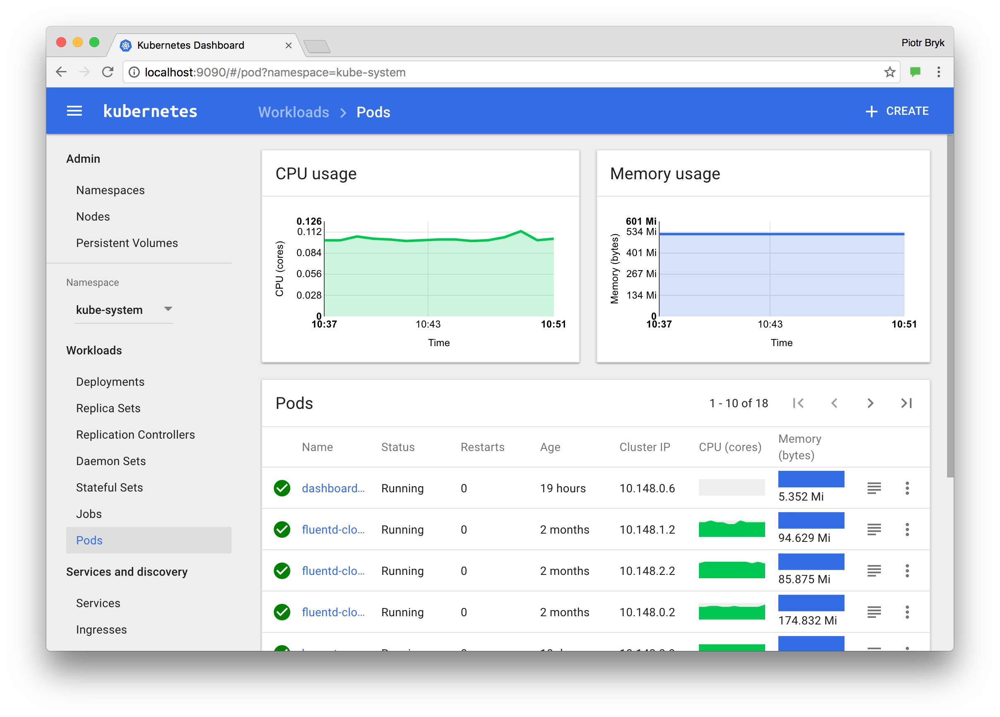
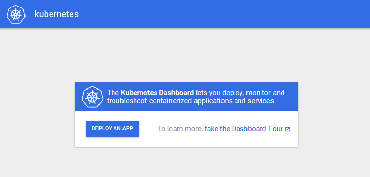
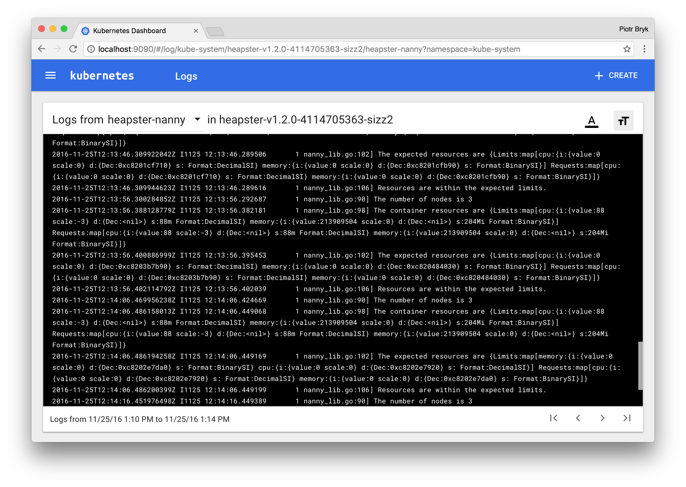

{}
**Kubernetes Dashboard є застарілим та не підтримується.**

Проєкт Kubernetes Dashboard заархівовано, і він більше не підтримується активно. Для нових встановлень розгляньте [Headlamp](https://headlamp.dev/).
{}


Про розгортання в кластері, подібне до Kubernetes Dashboard, дивіться [настанови зі встановлення Headlamp у кластері](https://headlamp.dev/docs/latest/installation/in-cluster/).


<!-- overview -->

Dashboard — це вебінтерфейс користувача Kubernetes. За допомогою Dashboard можна розгортати контейнеризовані застосунки в кластері Kubernetes, усувати несправності контейнеризованих застосунків і керувати ресурсами кластера. Також Dashboard дає змогу переглядати застосунки, що працюють у кластері, а ще створювати або змінювати окремі ресурси Kubernetes (як-от Deployments, Jobs, DaemonSets тощо). Наприклад, можна масштабувати Deployment, запустити поетапне оновлення, перезапустити Pod або розгорнути нові застосунки за допомогою майстра розгортання.

Dashboard також надає інформацію про стан ресурсів Kubernetes у кластері та про помилки, що могли виникнути.



<!-- body -->

## Розгортання інтерфейсу Dashboard {#deploying-the-dashboard-ui}


Наразі Kubernetes Dashboard підтримує лише встановлення за допомогою Helm, оскільки це швидше й дає нам кращий контроль над усіма залежностями, потрібними для роботи Dashboard.


Стандартно інтерфейс Dashboard не розгорнуто. Щоб розгорнути його, виконайте таку команду:

```shell
# Додайте репозиторій kubernetes-dashboard
helm repo add kubernetes-dashboard https://kubernetes.github.io/dashboard/
# Розгорніть Helm Release з назвою "kubernetes-dashboard" за допомогою чарта kubernetes-dashboard
helm upgrade --install kubernetes-dashboard kubernetes-dashboard/kubernetes-dashboard --create-namespace --namespace kubernetes-dashboard
```

## Доступ до інтерфейсу Dashboard {#accessing-the-dashboard-ui}

Щоб захистити дані кластера, Dashboard стандартно розгортається з мінімальною конфігурацією RBAC. Наразі Dashboard підтримує лише вхід за допомогою Bearer Token. Щоб створити токен для цієї демонстрації, скористайтеся нашим посібником зі [створення зразка користувача](https://github.com/kubernetes/dashboard/blob/master/docs/user/access-control/creating-sample-user.md).


Зразок користувача, створений у цьому навчальному матеріалі, матиме адміністративні привілеї й призначений лише для навчання.


### Проксі з командного рядка {#command-line-proxy}

Увімкнути доступ до Dashboard можна за допомогою інструмента командного рядка `kubectl`, виконавши таку команду:

```
kubectl -n kubernetes-dashboard port-forward svc/kubernetes-dashboard-kong-proxy 8443:443
```

`kubectl` зробить Dashboard доступним за адресою [https://localhost:8443](https://localhost:8443).

Доступ до інтерфейсу можливий _лише_ з машини, на якій виконано команду. Більше параметрів дивіться в `kubectl port-forward --help`.


Метод автентифікації kubeconfig **не** підтримує зовнішніх постачальників ідентифікації або автентифікацію на основі сертифікатів X.509.


## Вітальна сторінка {#welcome-view}

Коли ви відкриваєте Dashboard у порожньому кластері, показується вітальна сторінка. Вона містить посилання на цей документ, а також кнопку для розгортання вашого першого застосунку. Крім того, можна переглянути, які системні застосунки стандартно працюють у [просторі імен](/docs/tasks/administer-cluster/namespaces/) `kube-system` вашого кластера, наприклад сам Dashboard.



## Розгортання контейнеризованих застосунків {#deploying-containerized-applications}

Dashboard дає змогу створити й розгорнути контейнеризований застосунок як Deployment і необовʼязковий Service за допомогою простого майстра. Можна або вручну вказати параметри застосунку, або завантажити файл _маніфесту_ YAML чи JSON, що містить конфігурацію застосунку.

Натисніть кнопку **CREATE** у верхньому правому куті будь-якої сторінки, щоб розпочати.

### Встановлення параметрів застосунку {#specifying-application-details}

Майстер розгортання очікує від вас таку інформацію:

- **Назва застосунку** (обовʼязково): назва вашого застосунку. [Мітку](/docs/concepts/overview/working-with-objects/labels/) з цією назвою буде додано до Deployment і Service (якщо він є), які буде розгорнуто.

  Назва застосунку має бути унікальною в межах вибраного [простору імен](/docs/tasks/administer-cluster/namespaces/) Kubernetes. Вона має починатися з малої літери, закінчуватися малою літерою або цифрою й містити лише малі літери, цифри та дефіси (-). Довжина обмежена 24 символами. Пробіли на початку й у кінці ігноруються.

- **Образ контейнера** (обовʼязково): URL публічного [образу контейнера](/docs/concepts/containers/images/) Docker у будь-якому реєстрі або приватного образу (зазвичай розміщеного в Google Container Registry або Docker Hub). Специфікація образу контейнера має закінчуватися двокрапкою.

- **Кількість Podʼів** (обовʼязково): цільова кількість Podʼів, у яких ви хочете розгорнути застосунок. Значення має бути додатним цілим числом.

  Буде створено [Deployment](/docs/concepts/workloads/controllers/deployment/), щоб підтримувати потрібну кількість Podʼів у вашому кластері.

- **Service** (необовʼязково): для деяких частин застосунку (наприклад, фронтендів) може знадобитися відкрити доступ до [Service](/docs/concepts/services-networking/service/) через зовнішню, можливо публічну, IP-адресу поза кластером (зовнішній Service).

  
  Для зовнішніх Services може знадобитися відкрити один або кілька портів.
  

  Інші Services, видимі лише всередині кластера, називаються внутрішніми Services.

  Незалежно від типу Service, якщо ви вирішите створити Service і ваш контейнер слухає порт (вхідний), потрібно вказати два порти. Service буде створено зі зіставленням порту (вхідного) на цільовий порт, який бачить контейнер. Цей Service спрямовуватиме трафік до розгорнутих Podʼів. Підтримувані протоколи: TCP і UDP. Внутрішнім DNS-імʼям цього Service буде значення, вказане вище як назва застосунку.

За потреби можна розгорнути розділ **Advanced options**, де можна вказати інші налаштування:

- **Опис**: текст, який ви введете тут, буде додано як [анотацію](/docs/concepts/overview/working-with-objects/annotations/) до Deployment і показано в деталях застосунку.

- **Мітки**: стандартні [мітки](/docs/concepts/overview/working-with-objects/labels/) застосунку — це його назва та версія. Можна вказати додаткові мітки, які буде застосовано до Deployment, Service (якщо він є) і Podʼів, як-от release, environment, tier, partition і release track.

  Приклад:

  ```conf
  release=1.0
  tier=frontend
  environment=pod
  track=stable
  ```

- **Простір імен**: Kubernetes підтримує кілька віртуальних кластерів на основі одного фізичного кластера. Ці віртуальні кластери називаються [просторами імен](/docs/tasks/administer-cluster/namespaces/). Вони дають змогу розділяти ресурси на логічно названі групи.

  Dashboard пропонує всі доступні простори імен у випадному списку й дає змогу створити новий простір імен. Назва простору імен може містити не більше 63 алфавітно-цифрових символів і дефісів (-), але не може містити великих літер. Назви просторів імен не повинні складатися лише з цифр. Якщо назву задано як число, наприклад 10, Pod буде розміщено у стандартному просторі імен.

  Якщо простір імен створено успішно, його буде вибрано стандартно. Якщо створити його не вдалося, буде вибрано перший простір імен.

- **Secret для завантаження образу**: якщо вказаний образ контейнера Docker приватний, він може потребувати облікових даних із [Secret для завантаження образу](/docs/concepts/configuration/secret/).

  Dashboard пропонує всі доступні Secrets у випадному списку й дає змогу створити новий Secret. Назва Secret має відповідати синтаксису доменного імені DNS, наприклад `new.image-pull.secret`. Вміст Secret має бути закодований у base64 і вказаний у файлі [`.dockercfg`](/docs/concepts/containers/images/#specifying-imagepullsecrets-on-a-pod). Назва Secret може містити не більше 253 символів.

  Якщо Secret для завантаження образу створено успішно, його буде вибрано стандартно. Якщо створити його не вдалося, Secret не застосовується.

- **Вимога до CPU (ядра)** та **Вимога до памʼяті (MiB)**: можна вказати мінімальні [обмеження ресурсів](/docs/tasks/administer-cluster/manage-resources/memory-default-namespace/) для контейнера. Стандартно Podʼи працюють без обмежень на CPU і памʼять.

- **Команда запуску** та **Аргументи команди запуску**: стандартно контейнери виконують [команду entrypoint](/docs/tasks/inject-data-application/define-command-argument-container/), визначену у вказаному образі Docker. За допомогою параметрів і аргументів команди її можна перевизначити.

- **Запуск у привілейованому режимі**: це налаштування визначає, чи еквівалентні процеси в [привілейованих контейнерах](/docs/concepts/workloads/pods/#privileged-mode-for-containers) процесам, що виконуються від імені root на хості. Привілейовані контейнери можуть використовувати такі можливості, як керування мережевим стеком і доступ до пристроїв.

- **Змінні середовища**: Kubernetes надає відомості про Services через [змінні середовища](/docs/tasks/inject-data-application/environment-variable-expose-pod-information/). Можна складати змінні середовища або передавати аргументи командам, використовуючи значення змінних середовища. Їх можна використовувати в застосунках для пошуку Service. Значення можуть посилатися на інші змінні за допомогою синтаксису `$(VAR_NAME)`.

### Завантаження файлу YAML або JSON {#uploading-a-yaml-or-json-file}

Kubernetes підтримує декларативну конфігурацію. У цьому стилі вся конфігурація зберігається в маніфестах (файлах конфігурації YAML або JSON). Маніфести використовують схеми ресурсів [API](/docs/concepts/overview/kubernetes-api/) Kubernetes.

Замість того щоб вказувати параметри застосунку в майстрі розгортання, можна визначити застосунок в одному чи кількох маніфестах і завантажити файли за допомогою Dashboard.

## Використання Dashboard {#using-dashboard}

У наведених нижче розділах описано подання інтерфейсу Kubernetes Dashboard: що вони надають і як їх використовувати.

### Навігація {#navigation}

Коли в кластері визначено обʼєкти Kubernetes, Dashboard показує їх у початковому поданні. Стандартно показано лише обʼєкти з простору імен _default_; це можна змінити за допомогою селектора простору імен у меню навігації.

Dashboard показує більшість типів обʼєктів Kubernetes та групує їх у кілька категорій меню.

#### Огляд адміністратора {#admin-overview}

Для адміністраторів кластерів і просторів імен Dashboard перелічує Nodes, Namespaces і PersistentVolumes та має для них детальні подання. Подання списку Nodes містить метрики використання CPU й памʼяті, агреговані за всіма вузлами. Детальне подання показує метрики вузла, його специфікацію, статус, виділені ресурси, події та Podʼи, що працюють на вузлі.

#### Робочі навантаження {#workloads}

Показує всі застосунки, що працюють у вибраному просторі імен. Подання перелічує застосунки за типом робочого навантаження (наприклад, Deployments, ReplicaSets, StatefulSets). Кожен тип робочого навантаження можна переглядати окремо. Списки узагальнюють практичну інформацію про робочі навантаження, як-от кількість готових Podʼів у ReplicaSet або поточне використання памʼяті Podʼом.

Детальні подання робочих навантажень показують статус і специфікацію, а також звʼязки між обʼєктами. Наприклад, Podʼи, якими керує ReplicaSet, або нові ReplicaSets і HorizontalPodAutoscalers для Deployments.

#### Services

Показує ресурси Kubernetes, які дають змогу відкривати доступ до сервісів для зовнішнього світу й виявляти їх усередині кластера. Тому подання Service та Ingress показують Podʼи, на які вони спрямовані, внутрішні точки доступу для зʼєднань усередині кластера та зовнішні точки доступу для зовнішніх користувачів.

#### Сховище {#storage}

Подання сховища показує ресурси PersistentVolumeClaim, які застосунки використовують для зберігання даних.

#### ConfigMaps та Secrets {#config-maps-and-secrets}

Показує всі ресурси Kubernetes, що використовуються для поточної конфігурації застосунків, які працюють у кластерах. Подання дає змогу редагувати обʼєкти конфігурації й керувати ними та стандартно показує Secrets прихованими.

#### Переглядач логів {#logs-viewer}

Списки Podʼів і сторінки деталей містять посилання на переглядач логів, вбудований у Dashboard. Переглядач дає змогу детально вивчати логи контейнерів, що належать одному Podʼу.



## {} {#what-s-next}

Докладніше дивіться на [сторінці проєкту Kubernetes Dashboard](https://github.com/kubernetes/dashboard).

