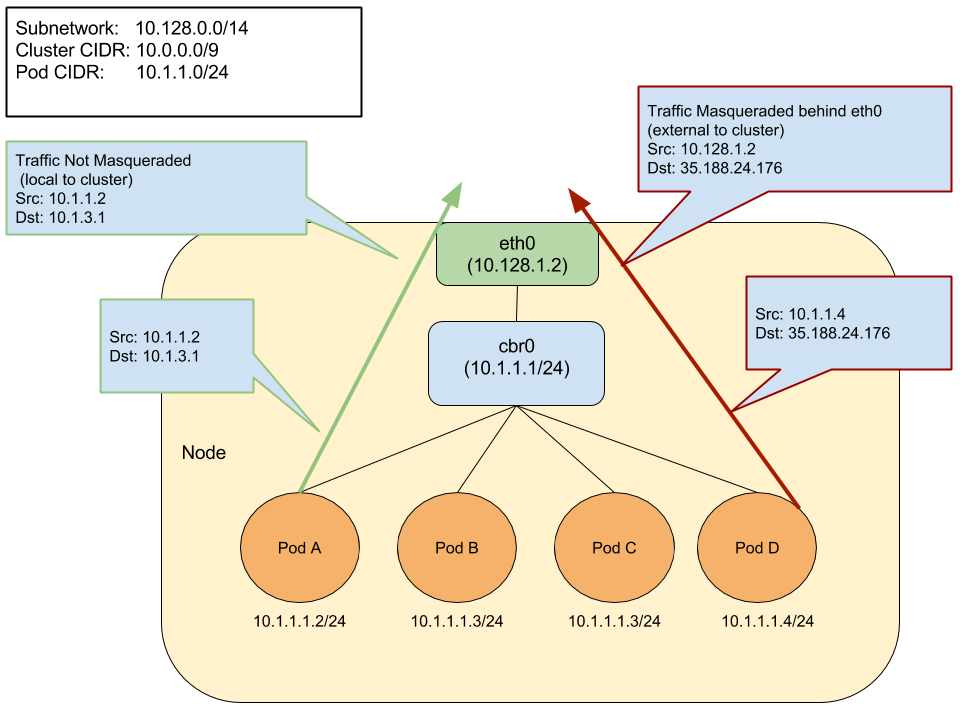

<!-- overview -->

Ця сторінка показує, як налаштувати та ввімкнути `ip-masq-agent`.

## {} {#before-you-begin}

 

<!-- discussion -->

## Керівництво користувача агента маскування IP {#ip-masquerade-agent-user-guide}

`ip-masq-agent` налаштовує правила iptables для приховування IP-адреси Podʼа за IP-адресою вузла кластера. Це зазвичай робиться, коли трафік надсилається до пунктів призначення за межами діапазону [CIDR](https://en.wikipedia.org/wiki/Classless_Inter-Domain_Routing) Podʼів кластера.

### Основні терміни {#key-terms}

* **NAT (Network Address Translation)**:
  Це метод переназначення однієї IP-адреси на іншу шляхом модифікації інформації адреси відправника та/або одержувача у заголовку IP. Зазвичай виконується пристроєм, що здійснює маршрутизацію IP.
* **Маскування (Masquerading)**: Форма NAT, яка зазвичай використовується для трансляції багатьох адрес в одну, коли кілька IP-адрес джерела маскуються за однією адресою, яка зазвичай є адресою пристрою, що виконує маршрутизацію IP. У Kubernetes це IP-адреса вузла.
* **CIDR (Classless Inter-Domain Routing)**:
  Заснований на маскуванні підмереж змінної довжини, дозволяє вказувати префікси довільної довжини. CIDR ввів новий метод представлення IP-адрес, тепер відомий як **нотація CIDR**, у якій адреса або маршрутизаційний префікс записується з суфіксом, що вказує кількість бітів префікса, наприклад 192.168.2.0/24.
* **Link-local**: Link-local-адреса — це мережева адреса, яка дійсна лише для комунікацій у межах сегмента мережі або домену розсилки, до якого підʼєднано хост. Link-local-адреси для IPv4 визначені в блоці адрес 169.254.0.0/16 у нотації CIDR.

`ip-masq-agent` налаштовує правила iptables для маскування IP-адрес вузлів/Podʼів під час надсилання трафіку до пунктів призначення за межами IP вузла кластера та діапазону Cluster IP. По суті, це приховує IP-адреси Podʼів за IP-адресою вузла кластера. У деяких середовищах трафік до "зовнішніх" адрес має надходити з відомої адреси машини. Наприклад, у Google Cloud будь-який трафік до Інтернету має виходити з IP VM. Коли використовуються контейнери, як у Google Kubernetes Engine, вихідний трафік з IP Podʼа буде відхилено. Щоб уникнути цього, ми повинні приховати IP Podʼа за власною IP-адресою VM — це зазвичай називають "маскуванням". Стандартно агент вважає три приватні діапазони IP, визначені [RFC 1918](https://tools.ietf.org/html/rfc1918), діапазонами [CIDR](https://en.wikipedia.org/wiki/Classless_Inter-Domain_Routing) без маскування. Ці діапазони — `10.0.0.0/8`, `172.16.0.0/12` і `192.168.0.0/16`. Агент також стандартно вважає link-local (169.254.0.0/16) CIDR без маскування. Агент налаштований перезавантажувати свою конфігурацію з розташування */etc/config/ip-masq-agent* кожні 60 секунд, і цей інтервал також можна налаштувати.



Файл конфігурації агента повинен бути написаний у синтаксисі YAML або JSON і може містити три необовʼязкові ключі:

* `nonMasqueradeCIDRs`: Список рядків у форматі [CIDR](https://en.wikipedia.org/wiki/Classless_Inter-Domain_Routing), які визначають діапазони без маскування.
* `masqLinkLocal`: Булеве значення (true/false), яке вказує, чи маскувати трафік до link-local префікса `169.254.0.0/16`. Стандартно — false.
* `resyncInterval`: Інтервал часу, через який агент намагається перезавантажити конфігурацію з диска. Наприклад: '30s', де 's' означає секунди, 'ms' — мілісекунди.

Трафік до діапазонів 10.0.0.0/8, 172.16.0.0/12 і 192.168.0.0/16 НЕ буде маскуватися. Будь-який інший трафік (вважається, що це Інтернет) буде маскуватися. Прикладом локального пункту призначення з Podʼа може бути IP-адреса його вузла, а також адреса іншого вузла або одна з IP-адрес у діапазоні IP кластера. Будь-який інший трафік стандартно буде маскуватися. Нижче наведено стандартний набір правил, які застосовує ip-masq-agent:

```shell
iptables -t nat -L IP-MASQ-AGENT
```

```none
target     prot opt source               destination
RETURN     all  --  anywhere             169.254.0.0/16       /* ip-masq-agent: cluster-local traffic should not be subject to MASQUERADE */ ADDRTYPE match dst-type !LOCAL
RETURN     all  --  anywhere             10.0.0.0/8           /* ip-masq-agent: cluster-local traffic should not be subject to MASQUERADE */ ADDRTYPE match dst-type !LOCAL
RETURN     all  --  anywhere             172.16.0.0/12        /* ip-masq-agent: cluster-local traffic should not be subject to MASQUERADE */ ADDRTYPE match dst-type !LOCAL
RETURN     all  --  anywhere             192.168.0.0/16       /* ip-masq-agent: cluster-local traffic should not be subject to MASQUERADE */ ADDRTYPE match dst-type !LOCAL
MASQUERADE  all  --  anywhere             anywhere             /* ip-masq-agent: outbound traffic should be subject to MASQUERADE (this match must come after cluster-local CIDR matches) */ ADDRTYPE match dst-type !LOCAL

```

Стандартно в GCE/Google Kubernetes Engine, якщо ввімкнено мережеву політику або ви використовуєте CIDR кластера не з діапазону 10.0.0.0/8, `ip-masq-agent` буде запущено у вашому кластері. Якщо ви працюєте в іншому середовищі, ви можете додати [DaemonSet](/docs/concepts/workloads/controllers/daemonset/) `ip-masq-agent` до свого кластера.

<!-- steps -->

## Створення ip-masq-agent {#create-an-ip-masq-agent}

Щоб створити ip-masq-agent, виконайте таку команду kubectl:

```shell
kubectl apply -f https://raw.githubusercontent.com/kubernetes-sigs/ip-masq-agent/master/ip-masq-agent.yaml
```

Також потрібно додати відповідну мітку вузла до всіх вузлів вашого кластера, на яких має працювати агент.

```shell
kubectl label nodes my-node node.kubernetes.io/masq-agent-ds-ready=true
```

Додаткову інформацію можна знайти в документації ip-masq-agent [тут](https://github.com/kubernetes-sigs/ip-masq-agent).

У більшості випадків стандартного набору правил має бути достатньо; однак, якщо це не так для вашого кластера, ви можете створити та застосувати [ConfigMap](/docs/tasks/configure-pod-container/configure-pod-configmap/), щоб налаштувати діапазони IP-адрес, яких це стосується. Наприклад, щоб ip-masq-agent враховував лише 10.0.0.0/8, ви можете створити такий [ConfigMap](/docs/tasks/configure-pod-container/configure-pod-configmap/) у файлі з назвою "config".


Важливо, щоб файл мав назву config, оскільки стандартно саме вона використовується як ключ для пошуку агентом `ip-masq-agent`:

```yaml
nonMasqueradeCIDRs:
  - 10.0.0.0/8
resyncInterval: 60s
```



Виконайте таку команду, щоб додати configmap до вашого кластера:

```shell
kubectl create configmap ip-masq-agent --from-file=config --namespace=kube-system
```

Це оновить файл, розташований у `/etc/config/ip-masq-agent`, який періодично перевіряється кожен `resyncInterval` та застосовується до вузла кластера. Після закінчення інтервалу синхронізації ви повинні побачити, що правила iptables відображають ваші зміни:

```shell
iptables -t nat -L IP-MASQ-AGENT
```

```none
Chain IP-MASQ-AGENT (1 references)
target     prot opt source               destination
RETURN     all  --  anywhere             169.254.0.0/16       /* ip-masq-agent: cluster-local traffic should not be subject to MASQUERADE */ ADDRTYPE match dst-type !LOCAL
RETURN     all  --  anywhere             10.0.0.0/8           /* ip-masq-agent: cluster-local
MASQUERADE  all  --  anywhere             anywhere             /* ip-masq-agent: outbound traffic should be subject to MASQUERADE (this match must come after cluster-local CIDR matches) */ ADDRTYPE match dst-type !LOCAL
```

Стандартно діапазон link-local (169.254.0.0/16) також обробляється ip-masq-agent, який налаштовує відповідні правила iptables. Щоб ip-masq-agent ігнорував link-local, ви можете встановити `masqLinkLocal` як true у ConfigMap.

```yaml
nonMasqueradeCIDRs:
  - 10.0.0.0/8
resyncInterval: 60s
masqLinkLocal: true
```
