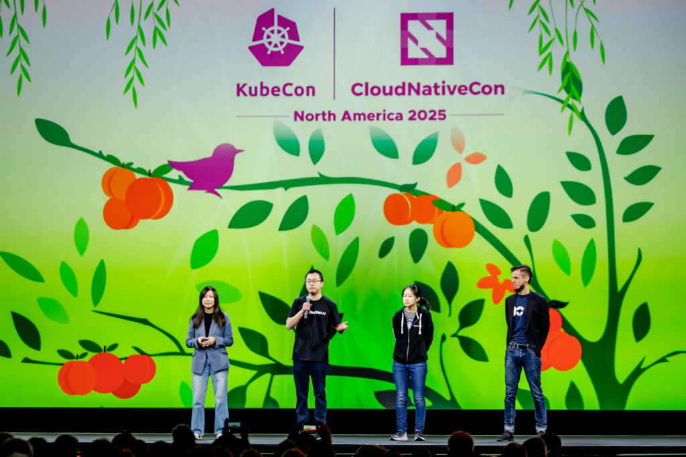
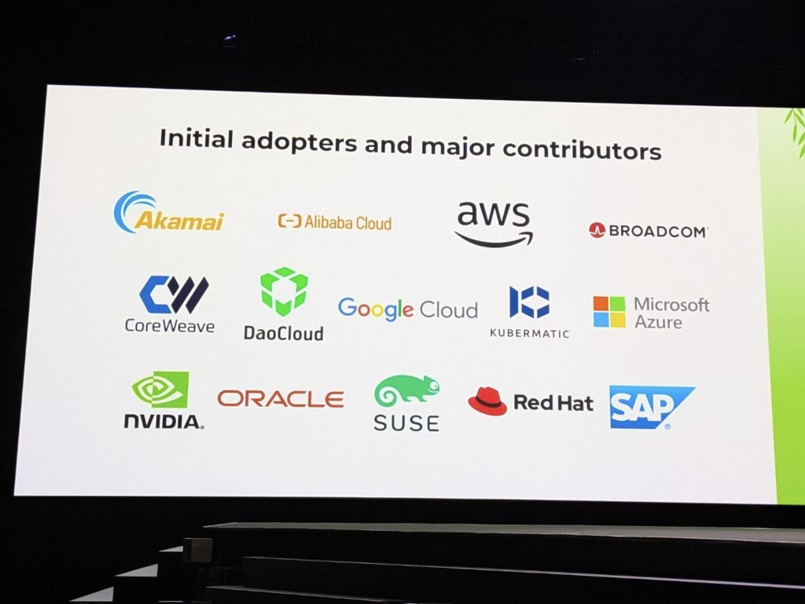

<!--
layout: blog
title: "From Working Group to SIG Architecture: spotlight on AI Conformance"
slug: sig-arch-ai-conformance-2026
draft: false
date: 2026-10-29T05:00:00-00:00
canonicalUrl: https://www.kubernetes.dev/blog/2026/10/29/sig-arch-ai-conformance-2026
author: >-

  Frederico Muñoz (SAS Institute),

  Kirti Goyal (independent)
-->

<!--
In this SIG Architecture spotlight we talked with [Janet Kuo](https://github.com/janetkuo) (Google)
and [Yuan Tang](https://github.com/terrytangyuan) (TensorScale AI) about the journey of AI Conformance in
Kubernetes, from the initial [Working
Group](https://github.com/kubernetes/community/blob/main/governance.md#working-groups) to the
integration [SIG Architecture](https://www.kubernetes.dev/community/community-groups/sigs/architecture/)
as a subproject.
-->
在本期 SIG Architecture 聚焦访谈中，我们与 [Janet Kuo](https://github.com/janetkuo)（Google）和
[Yuan Tang](https://github.com/terrytangyuan)（TensorScale AI）进行了交流，探讨了
AI Conformance 在 Kubernetes 中的发展历程：
从最初的[工作组](https://github.com/kubernetes/community/blob/main/governance.md#working-groups)，
到作为子项目融入
[SIG Architecture](https://www.kubernetes.dev/community/community-groups/sigs/architecture/)。

<!--
## Introductions

**Frederico Muñoz and Kirti Goyal (FK): Hi Janet, Yuan, and thank you for the opportunity to learn a
bit more about AI Conformance. Can you tell us a bit about yourselves and how you got involved in
Kubernetes?**
-->
## 自我介绍 {#introductions}

**Frederico Muñoz 和 Kirti Goyal（FK）：Janet、Yuan，你们好，感谢你们给我们这个机会，
让我们能更多地了解 AI Conformance。能否介绍一下你们自己，以及你们是如何参与 Kubernetes 的？**

<!--
**Janet Kuo**: I'm a Senior Staff Software Engineer at Google and have been a Kubernetes maintainer
since 2015, joining the community just as we were racing toward the 1.0 launch. I started my journey
writing the core workload controllers that standardized how applications are orchestrated on
Kubernetes. Today, I lead SIG Apps as a Co-chair & TL, and also lead the
[AI Conformance program](https://www.cncf.io/announcements/2025/11/11/cncf-launches-certified-kubernetes-ai-conformance-program-to-standardize-ai-workloads-on-kubernetes/).
My current focus is to ensure Kubernetes remains the best platform for the next generation of
workloads, such as AI.
-->
**Janet Kuo：** 我是 Google 的资深主任软件工程师，
自 2015 年起担任 Kubernetes 维护者，加入社区时我们正全力奔向 1.0 版本的发布。
我的职业生涯始于编写核心工作负载控制器，这些控制器确立了应用在 Kubernetes 上如何编排的标准。
如今，我作为联合主席兼技术负责人（TL）领导 SIG Apps，同时也负责
[AI Conformance 计划](https://www.cncf.io/announcements/2025/11/11/cncf-launches-certified-kubernetes-ai-conformance-program-to-standardize-ai-workloads-on-kubernetes/)。
我当前的重点是确保 Kubernetes 始终是下一代工作负载（例如 AI）的最佳平台。

<!--
**Yuan Tang**: I'm a co-founder of TensorScale AI where we build AI infrastructure for world models. Prior to that, I was a Senior Principal Software Engineer at Red Hat, where I led the development of Red Hat AI platform and upstream open source strategy. I became involved in Kubernetes early
on by fostering collaborations between the Kubernetes community and projects I was leading,
including Kubeflow, Argo, and KServe. I later helped found and lead [WG Serving](https://github.com/kubernetes-sigs/wg-serving) and the AI Conformance program, advancing
innovation and strengthening community collaboration around running AI workloads on Kubernetes.
-->
**Yuan Tang：** 我是 TensorScale AI 的联合创始人，我们公司为世界模型（world models）构建 AI 基础设施。
在此之前，我是 Red Hat 的资深首席软件工程师，
负责领导 Red Hat AI 平台的研发以及上游开源策略。我很早就参与 Kubernetes，
方式是促进 Kubernetes 社区与我当时领导的项目（包括 Kubeflow、Argo 和 KServe）之间的协作。
后来，我帮助创立并领导了 [WG Serving](https://github.com/kubernetes-sigs/wg-serving)
和 AI Conformance 计划，推动在 Kubernetes 上运行 AI 工作负载方面的创新，并加强社区协作。

<!--
## Program, Working Group, Subproject: the many shapes of AI Conformance

**FK: AI Conformance started as a CNCF Program, was it then you got involved?**
-->
## 计划、工作组、子项目：AI Conformance 的多种形态 {#program-working-group-subproject-the-many-shapes-of-ai-conformance}

**FK：AI Conformance 最初是 CNCF 的一个计划，你们是在那时参与进来的吗？**

<!--
**Janet Kuo:** I was actually involved from day one since I pitched the original idea. It became
obvious then that everyone was starting to run AI on Kubernetes, but vendors were building their
infrastructure stacks in different ways. I got worried about ecosystem fragmentation. So I wrote up
the initial Kubernetes AI Conformance Proposal, took it to the CNCF leadership to get their buy-in,
and started the AI Conformance Program. Once we had the green light, I reached out to my fellow
co-chairs Yuan Tang, Rita Zhang, and Mario Fahlandt to get the community rallied around it.
-->
**Janet Kuo：** 事实上，我从第一天起就参与了，因为这个最初的想法是我提出的。
当时情况已经很明显：所有人都在 Kubernetes 上运行 AI，但各家厂商构建基础设施栈的方式各不相同。
我担心生态系统会走向分裂。于是我撰写了最初的 Kubernetes AI Conformance 提案，
提交给 CNCF 领导层以获得他们的认可，随后启动了 AI Conformance 计划。
拿到许可之后，我联系了同为联合主席的 Yuan Tang、Rita Zhang 和 Mario Fahlandt，
让社区围绕这个计划团结起来。

<!--
**Yuan Tang:** Yes. I was a co-chair of WG Serving at that time and some of the initiatives such as
the [Gateway AI Inference Extension](https://gateway-api-inference-extension.sigs.k8s.io/) quickly
gained traction. There was a strong interest among the community to include inference-related
requirements in the Kubernetes AI Conformance program.
-->
**Yuan Tang：** 是的。当时我是 WG Serving 的联合主席，其中一些举措（例如
[Gateway AI Inference Extension](https://gateway-api-inference-extension.sigs.k8s.io/)）
很快就获得了广泛关注。社区内部有强烈的意愿，
希望把与推理相关的要求纳入 Kubernetes AI Conformance 计划。

<!--
**FK: How would you describe the motivation behind the creation of the AI Conformance Working Group?**
-->
**FK：你如何描述创建 AI Conformance 工作组的动机？**

<!--
**Janet and Yuan**: The motivation behind creating the Kubernetes AI Conformance [Working Group](https://github.com/kubernetes/community/blob/main/governance.md#working-groups) (AI WG) was
to address the rapid convergence of AI workloads onto Kubernetes while preventing ecosystem
fragmentation.
-->
**Janet 和 Yuan：** 创建 Kubernetes AI Conformance
[工作组](https://github.com/kubernetes/community/blob/main/governance.md#working-groups)
（AI WG）的动机，是在 AI 工作负载快速向 Kubernetes 汇聚的同时，防止生态系统走向分裂。

<!--
As AI adoption accelerated, organizations began running increasingly complex workloads, including
distributed training, large-scale inference, GPU-intensive pipelines, and emerging agentic AI
systems across many different Kubernetes platforms. However, vendors were implementing AI
infrastructure capabilities differently, especially around GPUs, networking, scheduling, and
inference orchestration. That created portability challenges, operational inconsistency, and growing
vendor lock-in concerns.
-->
随着 AI 的采用不断加速，各组织开始在许多不同的 Kubernetes 平台上运行日益复杂的工作负载，
包括分布式训练、大规模推理、GPU 密集型流水线以及新兴的智能体式 AI（agentic AI）系统。
然而，厂商在实现 AI 基础设施能力时方式各异，尤其是在 GPU、网络、调度和推理编排方面。
这带来了可移植性挑战、运维不一致，以及日益加剧的厂商锁定担忧。

<!--
The AI WG was formed to bring the community together around:

* vendor-neutral AI infrastructure standards,
* interoperable Kubernetes-based AI platforms,
* consistent operational behavior for AI workloads,
* and common requirements for scalable AI deployment.
-->
AI WG 的成立是为了让社区围绕以下方面凝聚共识：

* 厂商中立的 AI 基础设施标准，
* 可互操作的基于 Kubernetes 的 AI 平台，
* AI 工作负载一致的运维行为，
* 以及可扩展 AI 部署的共同要求。

<!--
**FK: WGs are temporary by nature, based on outcomes: would you say the main goals of the WG were achieved?**
-->
**FK：工作组本质上是临时的，并且以成果为导向：你认为该工作组的主要目标已经实现了吗？**

<!--
**Janet and Yuan**: Yes, the WG achieved its primary initial goals.
-->
**Janet 和 Yuan：** 是的，该工作组达成了其最初的主要目标。

<!--
The WG has succeeded in moving the ecosystem from: fragmented, vendor-specific AI infrastructure
approaches to a shared, community-defined baseline for AI workloads on Kubernetes.
-->
该工作组成功推动生态系统从碎片化、厂商特有的 AI 基础设施做法，
转向一套由社区共同定义的、面向 Kubernetes 上 AI 工作负载的基线。

<!--
Some concrete indicators of success include:

* Launching the Certified Kubernetes AI Conformance Program
* Defining formal Kubernetes AI Requirements (KARs)
* Getting broad participation from major ecosystem players
* Growing certified platforms from 18 to 31 within a few months
* Aligning around newer Kubernetes primitives needed for AI workloads
* Establishing a roadmap for automated conformance verification
-->
一些具体成果指标包括：

* 启动 Certified Kubernetes AI Conformance 计划
* 定义正式的 Kubernetes AI 要求（Kubernetes AI Requirements，KARs）
* 获得主要生态系统参与者的广泛参与
* 在几个月内将认证平台从 18 个增加到 31 个
* 就 AI 工作负载所需的较新 Kubernetes 原语达成一致
* 制定自动化一致性验证路线图

<!--
Most importantly, the WG created consensus that AI workloads are now a first-class Kubernetes use case.
-->
最重要的是，该工作组形成了共识：AI 工作负载现已成为 Kubernetes 的一等用例。

<!--
KubeCon stage with 4 persons in it, one of them talking.
-->

<!--
**FK: AI Conformance was specifically highlighted at the latest KubeCon: is this a reflection of the
growing importance of AI throughout the project?**
-->
**FK：AI Conformance 在最近一届 KubeCon 上被特别提及：这是否反映了 AI 在整个项目中日益增长的重要性？**

<!--
**Janet and Yuan**: Yes, the prominence of AI Conformance at the latest [KubeCon + CloudNativeCon](https://www.cncf.io/kubecon-cloudnativecon-events/) is a strong reflection of how
central AI has become to the Kubernetes ecosystem overall.
-->
**Janet 和 Yuan：** 是的，AI Conformance 在最近一届
[KubeCon + CloudNativeCon](https://www.cncf.io/kubecon-cloudnativecon-events/)
上的突出地位，强烈反映出 AI 对整个 Kubernetes 生态系统而言已变得多么核心。

<!--
A few years ago, AI workloads on Kubernetes were still viewed as somewhat specialized, mostly tied
to ML platforms or GPU-heavy research environments. What’s changed is that AI is now becoming a
mainstream infrastructure concern for nearly every large-scale platform operator.
-->
几年前，Kubernetes 上的 AI 工作负载仍被视为相当专门的领域，
主要与机器学习（ML）平台或 GPU 密集型研究环境相关。
发生变化的地方在于，AI 现在正成为几乎所有大规模平台运维者都要关注的主流基础设施议题。

<!--
That shift naturally elevates AI from an application running on Kubernetes to a core workload
category Kubernetes must optimize for.
-->
这种转变自然地把 AI 从 Kubernetes 上运行的一种应用，
提升为 Kubernetes 必须专门优化的一类核心工作负载。

<!--
The AI Conformance initiative reflects that evolution. It signals that the community now sees AI
infrastructure requirements, things like accelerator scheduling, high-performance networking,
workload-aware orchestration, and low-latency inference, as important enough to standardize at the
ecosystem level.
-->
AI Conformance 举措反映了这一演进。它表明社区现在认为 AI 基础设施需求 ——
例如加速器调度、高性能网络、工作负载感知编排和低延迟推理 ——
已经重要到需要在生态系统层面加以标准化。

<!--
Its visibility at KubeCon also shows a broader strategic realization: if Kubernetes is going to
remain the universal control plane for modern infrastructure, it needs to provide a consistent
foundation for AI workloads across clouds, on-prem, and edge environments.
-->
它在 KubeCon 上的可见度也体现了更广泛的战略认知：如果 Kubernetes 要继续作为现代基础设施的通用控制平面，
它就需要为跨云、本地和边缘环境中的 AI 工作负载提供一致的基础。

<!--
So the emphasis on AI Conformance is not just about chasing AI hype; it's about Kubernetes adapting
to a major shift in workload patterns and ensuring the ecosystem evolves cohesively rather than
fragmenting into vendor-specific AI stacks.
-->
因此，对 AI Conformance 的强调并不只是追逐 AI 热潮；
它关乎 Kubernetes 适应工作负载模式的重大转变，并确保生态系统协调一致地演进，
而不是分裂成厂商专有的 AI 技术栈。

<!--
(slide) Initial adopters and major contributors: Akamai (logo), Alibaba Cloud (logo), AWS (logo), Broadcom (logo), CoreWeave (logo), DaoCloud (logo), Google Cloud (logo), Kubermatic (logo), Microsoft Azure (logo), NVIDIA (logo), Oracle (logo), SUSE (logo), Red Hat (logo), SAP (logo)
-->

<!--
## From Working Group to SIG Architecture subproject

**FK: How would you describe the change from WG to SIG? Is it a reflection of AI as something that
requires ongoing architectural governance?**
-->
## 从工作组到 SIG Architecture 子项目 {#from-working-group-to-sig-architecture-subproject}

**FK：你如何描述从工作组到 SIG 的转变？这是否反映了 AI 属于需要持续架构治理的事物？**

<!--
**Janet and Yuan**: In Kubernetes, Working Groups are meant to be temporary. Our WG had a specific
goal to get the initial Kubernetes AI Conformance requirements published and get the certification
process off the ground. Once we hit those milestones, we [archived the WG](https://github.com/kubernetes/community/tree/main/archive/wg-ai-conformance) and moved AI
Conformance to be a [permanent subproject](https://github.com/kubernetes/community/tree/main/sig-architecture#subprojects) under
SIG Architecture.
-->
**Janet 和 Yuan：** 在 Kubernetes 中，工作组本来就是临时的。
我们的工作组有明确的目标：发布最初的 Kubernetes AI Conformance 要求，并让认证流程运转起来。
达成这些里程碑之后，我们[归档了该工作组](https://github.com/kubernetes/community/tree/main/archive/wg-ai-conformance)，
并将 AI Conformance 转为 SIG Architecture 下的[永久子项目](https://github.com/kubernetes/community/tree/main/sig-architecture#subprojects)。

<!--
Moving to SIG Architecture definitely proves that AI needs ongoing governance. AI isn’t just a
passing trend or a one-off workload. It has become a core part of what Kubernetes runs every day.
Because SIG Architecture already owns overall Kubernetes Conformance and API design principles,
housing the AI Conformance subproject there makes perfect sense. It makes sure our AI Conformance
requirements stay aligned with the rest of the Kubernetes ecosystem for the long haul.
-->
迁移到 SIG Architecture 无疑证明 AI 需要持续的治理。AI 不是短暂的潮流，也不是一次性的工作负载。
它已成为 Kubernetes 日常运行内容的核心部分。由于 SIG Architecture 本就负责 Kubernetes
总体一致性（Conformance）和 API 设计原则，把 AI Conformance 子项目放在那里完全合理。
这能确保我们的 AI Conformance 要求在长期内与 Kubernetes 生态系统的其余部分保持一致。

<!--
**FK: And with that change, how would you describe the main goals and areas of intervention of the subproject?**
-->
**FK：伴随这一转变，你如何描述该子项目的主要目标和工作领域？**

<!--
**Janet and Yuan**: Now that we’re a subproject, our main goal is to keep the AI Conformance
standards current, vendor-neutral, and standard-setting. We want to make sure Kubernetes captures
the latest advancements in AI infrastructure while keeping the ecosystem fair for everyone. When we
find gaps where no clear community pattern exists, we help foster and form new standards to solve
them.
-->
**Janet 和 Yuan：** 现在我们是一个子项目，主要目标是让 AI Conformance 标准保持最新、厂商中立并起到标准引领作用。
我们希望确保 Kubernetes 能纳入 AI 基础设施的最新进展，同时让生态系统对每个人都公平。
当我们发现某些空白领域尚不存在明确的社区模式时，我们会帮助培育并形成新标准来填补它们。

<!--
## AI Conformance and Kubernetes
-->
## AI Conformance 与 Kubernetes {#ai-conformance-and-kubernetes}

<!--
**FK: AI Infrastructure is evolving very quickly, while Kubernetes APIs are designed to remain
stable for years. Is this something you consider a challenge?**
-->
**FK：AI 基础设施演进非常快，而 Kubernetes API 的设计目标是多年保持稳定。你们认为这是一个挑战吗？**

<!--
**Janet and Yuan**: It’s definitely a tricky balance. AI moves very fast, while Kubernetes is
designed to be stable and boring. But we actually structured the program around this exact tension.
-->
**Janet 和 Yuan：** 这确实是一个微妙的平衡。AI 发展非常快，而 Kubernetes 的设计目标是稳定、不出意料。
不过我们正是围绕这一张力来构建该计划的。

<!--
First, we use a tiered graduation model. When new AI infrastructure concepts emerge, we introduce
them as recommended SHOULD requirements. That gives the ecosystem room to experiment and agree on
best practices without locking Kubernetes into rigid APIs too early. Once those APIs stabilize and
with ecosystem adoption, we graduate them to mandatory MUST requirements.
-->
第一，我们采用分层晋级模型。当新的 AI 基础设施概念出现时，我们先将其作为建议性的 SHOULD 要求引入。
这样，生态系统就有空间去试验并就最佳实践达成一致，而不会过早把 Kubernetes 锁定在僵化的 API 上。
一旦这些 API 稳定下来并获得生态系统的采用，我们就将其晋级为强制性的 MUST 要求。

<!--
Second, we intentionally keep our focus on the infrastructure layer. We test for core capabilities
like accelerator support through [Dynamic Resource Allocation](/docs/concepts/scheduling-eviction/dynamic-resource-allocation/) (DRA), rather than getting bogged down
in specific AI frameworks or model servers. That keeps the base platform stable while letting the AI
tooling evolve as fast as it needs to.
-->
第二，我们有意把关注点保持在基础设施层面。我们通过
[动态资源分配（Dynamic Resource Allocation，DRA）](/zh-cn/docs/concepts/scheduling-eviction/dynamic-resource-allocation/)
来测试加速器支持等核心能力，而不是深陷于特定的 AI 框架或模型服务器之中。
这样既保持基础平台稳定，又让 AI 工具链能按所需速度自由演进。

<!--
**FK: DRA has evolved, also due to the work of WG Device Management, as an important part of
Kubernetes (and especially so for AI workloads), with SIG Architecture having an important role in
how it’s integrated in Kubernetes: do you find any parallel in this? Specifically, do you think
there will be a heavier focus in the integration with the evolving Kubernetes architecture as part
of SIG Architecture?**
-->
**FK：得益于 WG Device Management 的工作，DRA 已成为 Kubernetes 的重要组成部分
（对 AI 工作负载尤其如此），而 SIG Architecture 在 DRA 如何集成到 Kubernetes 方面发挥了重要作用：
你们觉得这里有相似之处吗？具体来说，你认为作为 SIG Architecture 的一部分，
未来会更着重关注 DRA 与不断演进的 Kubernetes 架构的集成吗？**

<!--
**Janet and Yuan**: There is a huge parallel there. Whenever we face a massive, complicated
challenge that touches multiple parts of the codebase and involves multiple SIGs, a Working Group is
the best place to start. It lets experts from different SIGs get together to figure out the problem,
and build consensus.
-->
**Janet 和 Yuan：** 这里有极大的相似之处。
每当我们面对一个规模庞大、复杂、涉及代码库多个部分并牵涉多个 SIG 的挑战时，工作组都是最佳的起点。
它让来自不同 SIG 的专家聚在一起弄清楚问题，并建立共识。

<!--
Being part of SIG Architecture means there will be a much heavier focus on how AI capabilities weave
into the evolving Kubernetes architecture. Instead of treating AI as an add-on layer, we’re looking
at how core Kubernetes primitives, like scheduling and resource allocation, need to adapt at a
foundational level to support the next decade of AI workloads.
-->
成为 SIG Architecture 的一部分，意味着我们会更加着重关注 AI 能力如何融入不断演进的 Kubernetes 架构。
我们不再把 AI 视为附加层，而是审视调度和资源分配等 Kubernetes
核心原语需要在基础层面如何调整，以支撑未来十年的 AI 工作负载。

<!--
## Final remarks

**FK: For interested contributors, what’s the best way to get involved with the AI Conformance subproject?**
-->
## 结语 {#final-remarks}

**FK：对于有兴趣的贡献者，参与 AI Conformance 子项目的最佳方式是什么？**

<!--
**Janet and Yuan**: We're always looking for new contributors. The easiest way to get started is by checking out our
main repo at [kubernetes-sigs/ai-conformance](https://github.com/kubernetes-sigs/ai-conformance) and
join our [meetings](https://www.kubernetes.dev/community/community-groups/sigs/architecture/#meetings). If
you're interested in defining new AI Conformance requirements, you can jump into PR reviews or
propose your own using our [KAR template](https://github.com/kubernetes-sigs/ai-conformance/tree/main/kars/NNNN-kar-template). If
you want to write code, we always need help expanding our automated Go test suites in the [`test/` directory](https://github.com/kubernetes-sigs/ai-conformance/tree/main/test).
-->
**Janet 和 Yuan：** 我们一直在寻找新的贡献者。最简单的入门方式是查看我们的主仓库
[kubernetes-sigs/ai-conformance](https://github.com/kubernetes-sigs/ai-conformance)，
并参加我们的[会议](https://www.kubernetes.dev/community/community-groups/sigs/architecture/#meetings)。
如果你有兴趣定义新的 AI Conformance 要求，可以参与 PR 审查，或者使用我们的
[KAR 模板](https://github.com/kubernetes-sigs/ai-conformance/tree/main/kars/NNNN-kar-template)提出你自己的要求。
如果你想写代码，我们一直需要有人帮忙扩展
[`test/` 目录](https://github.com/kubernetes-sigs/ai-conformance/tree/main/test)中的自动化 Go 测试套件。

<!--
For vendors looking to certify their platforms, all the details are at
[cncf/k8s-ai-conformance](https://github.com/cncf/k8s-ai-conformance).
-->
对于希望为自己的平台做认证的厂商，所有细节都在
[cncf/k8s-ai-conformance](https://github.com/cncf/k8s-ai-conformance) 中。

<!--
**FK: Any final comments you would like to share?**
-->
**FK：你们还有什么最后想分享的吗？**

<!--
**Janet and Yuan**: We’ve been blown away by how
fast the community has rallied around this. When we first announced the AI Conformance program
during the keynote at [KubeCon NA 2025](https://www.cncf.io/reports/kubecon-cloudnativecon-north-america-2025/), we weren’t sure what
the response would be.
-->
**Janet 和 Yuan：** 社区如此迅速地围绕这项工作团结起来，让我们深感震撼。
当我们在 [KubeCon NA 2025](https://www.cncf.io/reports/kubecon-cloudnativecon-north-america-2025/)
的主题演讲中首次宣布 AI Conformance 计划时，我们并不确定会有怎样的反响。

<!--
But by the time we gave our update keynote at [KubeCon EU 2026](https://events.linuxfoundation.org/kubecon-cloudnativecon-europe/), we had grown from 18
certified platforms to 31 in just a few months.
-->
但等到我们在 [KubeCon EU 2026](https://events.linuxfoundation.org/kubecon-cloudnativecon-europe/)
做进展更新主题演讲时，获认证的平台已在短短几个月内从 18 个增长到 31 个。

<!--
That kind of growth shows just how much the industry wanted a unified, vendor-neutral standard. It
gives organizations the confidence that they can run their AI workloads on any certification
Kubernetes platform without getting locked into a proprietary stack.
-->
这样的增长说明整个行业多么渴望一个统一、厂商中立的标准。
它让各组织有信心在任何已认证的 Kubernetes 平台上运行自己的 AI 工作负载，
而不会被锁定在专有技术栈中。

<!--
If you’re a platform vendor, we’d love to see you get certified. If you’re a developer interested in
the intersection of AI and cloud-native infrastructure, come join us in SIG Architecture!
-->
如果你是平台厂商，我们很希望看到你通过认证。
如果你是一名对 AI 与云原生基础设施交叉领域感兴趣的开发者，欢迎加入 SIG Architecture！

<!--
**FK: Excellent, thank you both for guiding us in this journey on AI and AI Conformance in Kubernetes.**
-->
**FK：太好了，感谢你们两位带我们走过这段 Kubernetes 中 AI 与 AI Conformance 的旅程。**
